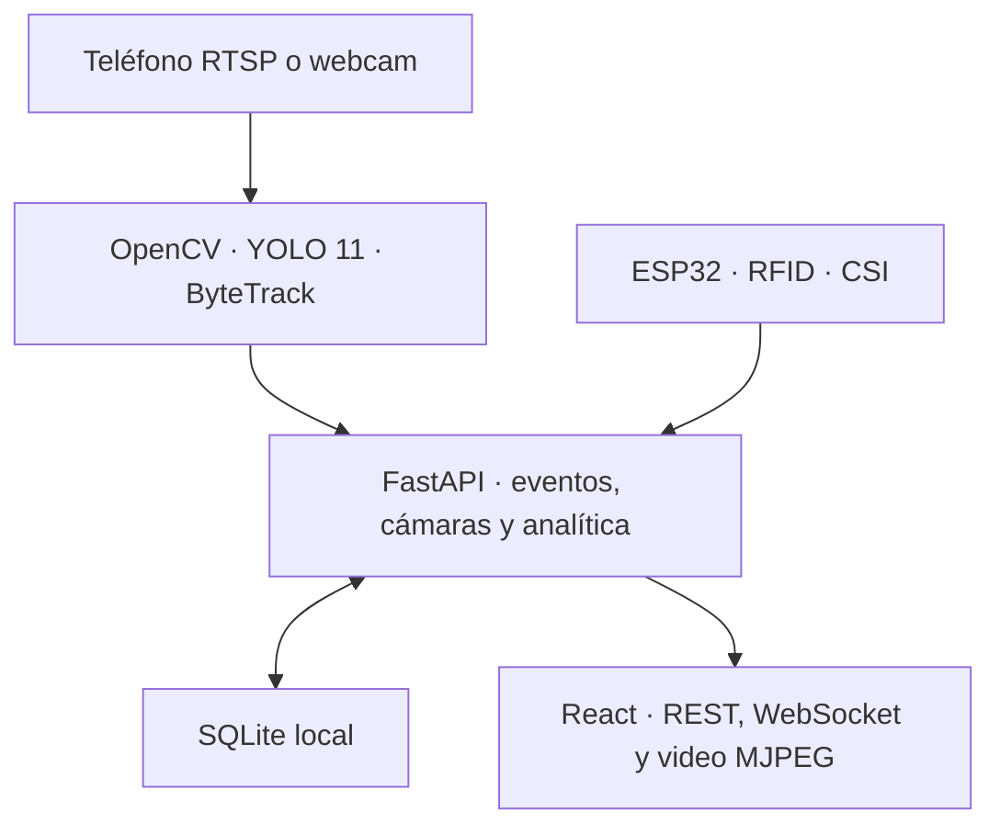

# Factory Pulse

Plataforma local de análisis de flujo industrial. Procesa cámaras en vivo para
detectar personas con IDs temporales y visualizar ocupación, recorridos y
permanencia. No hace reconocimiento facial ni almacena video.

## Arranque desde un clon limpio

Requisitos verificados para esta línea base: Python 3.12 y Node.js 22.12+
(incluido Node 24). Ejecuta los comandos desde la raíz. Antes de actualizar
una instalación existente, detén el backend y respalda su archivo SQLite,
la llave de cámara y las calibraciones. Si la base antigua fue alimentada por
el simulador, inicia con otra base: no se borra ni migra su historial al arrancar.

**Terminal 1 · API (PowerShell)**

```powershell
if (-not (Test-Path .env)) { Copy-Item .env.example .env }
py -3.12 -m venv .venv-backend
.\.venv-backend\Scripts\python.exe -m pip install -r backend/requirements.txt
.\.venv-backend\Scripts\python.exe -m uvicorn --app-dir backend app.main:app --host 127.0.0.1 --port 8000
```

En Linux/macOS, usa `cp -n .env.example .env`, `python3.12 -m venv .venv-backend`
y sustituye `.\.venv-backend\Scripts\python.exe` por `.venv-backend/bin/python`.
Comprueba [el estado de la API](http://127.0.0.1:8000/api/health).
El comando crea `factory_pulse.db` en la raíz si no existe. Si tu instalación
anterior se lanzaba desde `backend/` y la base está en esa carpeta, configura
explícitamente `DATABASE_URL` antes de arrancar. No copies encima de una base existente.

**Preparar visión · antes de registrar la cámara**

```powershell
py -3.12 -m venv .venv-vision
.\.venv-vision\Scripts\python.exe -m pip install -r hardware/vision_requirements.txt
```

En Linux/macOS usa el equivalente `.venv-vision/bin/python`. Los pesos pueden
descargarse en el primer arranque. Ve a la [guía de visión](docs/VISION_YOLO_RTSP.md)
para elegir el perfil, calibrar y diagnosticar RTSP.

**Terminal 2 · dashboard**

```sh
cd frontend
npm ci
npm run dev -- --host 127.0.0.1
```

Abre [Factory Pulse](http://127.0.0.1:3000). Registra tu teléfono en
**Cámara → Agregar cámara**, en la misma red Wi-Fi que la PC. En **Editar layout**
introduce las dimensiones reales antes de interpretar distancias o zonas.

## Flujo de datos y operación



| Proceso | Puerto inicial | Configuración |
|---|---:|---|
| FastAPI | 8000 | `--port` de Uvicorn |
| Vite | 3000 | `--port` de Vite; proxy `FP_API_TARGET` en `.env` |
| Proveedores de visión | 8101–8199 | `VISION_PORT_START` y `VISION_PORT_END` |

Al cambiar el puerto de FastAPI, ajusta también `VISION_BACKEND_URL` y
`FP_API_TARGET`. Los puertos de visión administrada sólo escuchan en loopback.
Para hardware IoT, vincula FastAPI a la IP de la red de pruebas y configura
esa IP en el firmware. No expongas la API ni los streams a Internet.

Más detalles: [visión RTSP](docs/VISION_YOLO_RTSP.md),
[despliegue en Windows](docs/PROMPT_DESPLIEGUE_PC.md) y
[hardware](docs/HARDWARE.md) y [línea base técnica](docs/LINEA_BASE_TECNICA.md).
